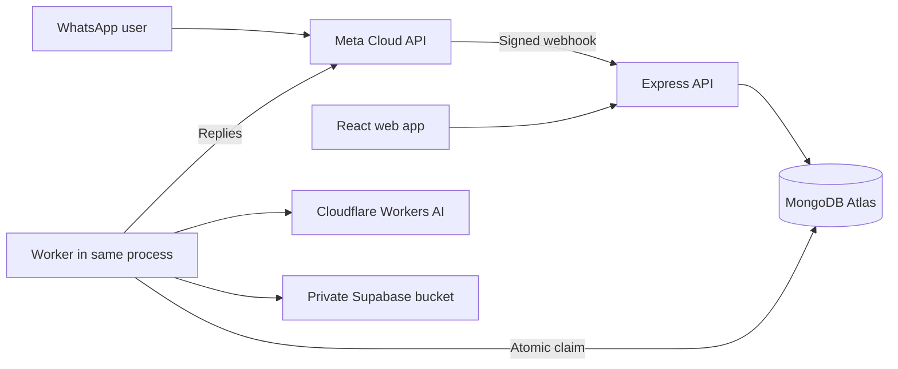

# Engram

Save from WhatsApp or the web. Find your saved content later.

## Problem Statement
People save notes, links, screenshots and PDFs in WhatsApp, then struggle to retrieve them by topic or meaning.

## Target Users
Students and young professionals, initially classmates and hostel mates.

## Solution
Users send content to Engram's business number or use Web Quick Add. Express saves it, a Mongo-backed worker enriches it, and a private timeline supports keyword/semantic search and grounded Q&A.

## Key Features
- Links, Upcoming, Photos and password-unlocked Confidential sections; protected items are excluded from AI search and answers.
- Evidence-backed event dates and in-app reminders in the final 24 hours, urgent within one hour; original-message date filters use India time in the web app.
- Image transcription followed by text enrichment provides searchable visual subjects and deadline extraction. New and older files are classified automatically through the worker, with no manual review. Mark private uploads confidential before saving to skip AI.
- **Optional personal WhatsApp connector:** a local, unofficial Baileys adapter was requested on 26 Oct after Meta account restrictions blocked setup. See [connector setup and limitations](connector/README.md). Baileys 7.0.0-rc14 is installed and pinned; parser/outbox and backend capture tests pass, but live pairing remains unverified. This is an explicit change to the original official-API-only scope.
- Register/login/logout with bcrypt and JWT in httpOnly cookies; user-scoped item access.
- Signed Meta webhooks, batched message parsing, duplicate item/job protection and queued bot acknowledgements.
- Web capture for notes, links, JPEG/PNG/WebP images and PDFs up to 10 MB.
- Background link analysis, image OCR and PDF extraction through Cloudflare Workers AI, with validated JSON, one repair retry, embeddings and visible failure/retry states.
- Atlas Search and Vector Search combined with RRF; type/date/category filters and explicit fallback warnings.
- Timeline status filters, stable cursor pagination, private media viewing, editable tags/category and deletion with storage cleanup.
- Per-user daily AI-call budget, worker backoff, terminal failure state and stuck-job recovery.

These features depend on valid external configuration. See the release verification status below; implementation does not establish live provider success.

## Tech Stack
React 18/Vite, Node.js/Express 5, Mongoose/MongoDB Atlas, Supabase private object storage, Meta WhatsApp Cloud API and Cloudflare Workers AI REST API. Native Node test runner; no new dependencies were required for the reliability changes.

## Architecture


| Decision | Reason |
|---|---|
| One MERN deployment | Express serves the React build and APIs on one origin. |
| MongoDB jobs | Atomic claim, retry and dead-letter state without Redis. |
| Same-process worker | Small deployment; a heartbeat protects long jobs. |
| Atlas text/vector search | One database, owner pre-filters, no separate vector database. |
| Small LLM wrapper using fetch | Provider HTTP, JSON validation and repair are in one file. |
| Private object storage | Store media outside MongoDB; authorize ownership before issuing a signed link. |

Idempotency uses unique message IDs and job deduplication keys. Async processing keeps media downloads and AI outside the webhook. Retries use 30s → 120s → 480s backoff; failed jobs can be retried. Item indexes cover owner/timestamp and owner/type. Rate limiting is in-memory for one instance. AI quotas are stored atomically in MongoDB and reset by UTC day.

Back-of-envelope assumption: 100 users × 20 items/day gives 2,000 items/day. One 768-number vector is roughly 6 KB before BSON/index overhead; media dominates storage. The serial worker and free-tier quotas are prototype limits, not a production capacity claim.

Deliberately omitted: caching layer, Redis, message broker, microservices, LangChain, Kubernetes and a separate vector database; this fixed pipeline does not justify their operational cost.

## Local Setup
Use a Node version supported by the installed packages (Node 24 was used for local verification).

1. Install dependencies in `server/` and `client/` with `npm ci`.
2. Copy `server/.env.example` to `server/.env` yourself and fill the values. Never commit or share this file.
3. Create a **private** Supabase bucket named `engram-media`.
4. From `client/`, run `npm run build`. Vite writes directly to `server/public`.
5. From `server/`, run `npm start`. Open http://localhost:8000.
6. For frontend development, use `npm run dev` in `client/`; Vite proxies `/api` to port 8000.

From `server/`, run `node scripts/searchIndexes.mjs --apply` to create/update the required `text_index` and `vector_index`. Wait until both are queryable; `node scripts/searchIndexes.mjs` reports their state. The definitions include owner, type, timestamp, effective category and embedding model filters.

Old embeddings must be regenerated when their model changes, even if both models have 768 dimensions. Use **Reprocess** on completed items. The search deliberately excludes embeddings from other model spaces.

### Checks
```text
cd server
npm test
cd ../client
npm run build
```
The optional Postman simulation checks the real AI HTTP client against a local stand-in, not real model quality. Commands are in [the simulation context](postman/simulations/ai-local.context.md). The optional `node scripts/verifyLive.mjs` uses temporary synthetic records and removes them afterward; `--without-storage` skips the upload/download prerequisite.

Backend tests place temporary MongoDB data under the ignored `.cache/test-tmp` directory on the project drive. This avoids relying on the system drive, which was nearly full during verification. Run connector tests separately with `npm test` in `connector/`.

## Environment Variables
The full placeholder template is `server/.env.example`. Set secrets in the server environment only.

| Variable | Purpose |
|---|---|
| `PORT`, `NODE_ENV` | HTTP port and production cookie behavior |
| `MONGODB_URI`, `JWT_SECRET` | Atlas connection and JWT signing |
| `CLIENT_ORIGIN` | Exact frontend origin allowed by the backend (Vite locally; Vercel in production) |
| `CLOUDFLARE_ACCOUNT_ID` | Cloudflare account ID, 32 hexadecimal characters |
| `CLOUDFLARE_API_TOKEN` | Server-only Workers AI token |
| `DAILY_AI_CALL_LIMIT` | Application budget per user per UTC day; default 100, not the provider's quota |
| `SUPABASE_URL`, `SUPABASE_SERVICE_ROLE_KEY` | Server-only private media access |
| `WHATSAPP_APP_SECRET`, `WHATSAPP_VERIFY_TOKEN` | Webhook signature and GET verification |
| `WHATSAPP_ACCESS_TOKEN`, `WHATSAPP_PHONE_NUMBER_ID` | Media retrieval and replies |
| `WHATSAPP_API_VERSION` | Configurable Graph version; default `v23.0`, verify against your Meta app |

`CLOUDFLARE_BASE_URL` and `WHATSAPP_BASE_URL` are optional test overrides. Do not point a real credential at an untrusted host. Cloudflare is the only AI provider; old provider settings are ignored. Follow [Cloudflare setup](docs/cloudflare-setup.md) for credentials, model terms, free allowance and synthetic verification.

Provider references: [Cloudflare vision](https://developers.cloudflare.com/workers-ai/models/llama-3.2-11b-vision-instruct/), [embeddings](https://developers.cloudflare.com/workers-ai/models/bge-base-en-v1.5/), [PDF conversion](https://developers.cloudflare.com/workers-ai/features/markdown-conversion/), [Meta's message contract](https://www.postman.com/meta/whatsapp-business-platform/folder/o48mro7/messages).

## Deployment
Recorded hosted URL: https://engram-eont.onrender.com. The current local changes must be deployed before that URL serves them; this session has not verified the hosted release or demo credentials.

Render configuration: root directory `server`, build command `bash build.sh`, start command `npm start`. Configure server variables with `NODE_ENV=production` and `CLIENT_ORIGIN` set to the exact Vercel production URL. Register `https://YOUR_RENDER_HOST/webhook/whatsapp` with Meta.

Vercel configuration: root directory `client`, framework preset `Vite`, default build command, default output directory (`dist`), and default install command. The browser calls `/api` on its own Vercel origin; `client/vercel.json` forwards these requests to `https://engram-eont.onrender.com/api` before the SPA fallback. This keeps login cookies on the frontend site and avoids third-party cookie blocking. API responses are excluded from rewrite caching. No frontend API environment variable is required; the previous `VITE_API_BASE_URL` setting is unused. Update the rewrite destination if the Render hostname changes. Verify `/api/health`, SPA deep-link refreshes, login persistence and all workflows in incognito.

**Meta test mode:** only explicitly whitelisted phone numbers can use the test business number. The official API cannot read personal chats. Evaluators can use Web Quick Add; image/PDF capture also requires configured private storage.

Do not publish demo credentials until the account exists and its login has been tested. Use a dedicated account without personal saved content.

### Verification status — 25 Oct 2026
- Local signature, duplicate capture, HTTP auth/isolation, pagination, edits, SSRF and worker/quota checks passed.
- Local React production build passed.
- Postman AI simulation passed JSON repair, successful enrichment, embeddings, HTTP 429/503 handling and terminal failure behavior.
- Local app connected to Atlas and served the UI; unauthenticated item requests returned 401.
- Both Atlas indexes are READY and queryable. A live synthetic-vector check passed owner/type/date/category isolation on text and vector search; this verifies filtering, not semantic relevance.
- Gemini previously returned billing errors and Groq returned HTTP 401. Both integrations have been replaced by Cloudflare. Cloudflare local HTTP and Postman simulation tests pass; live account credentials, model access and output quality still need verification using [the setup guide](docs/cloudflare-setup.md).
- Supabase credentials are configured locally. The private `engram-media` bucket was created and a synthetic PDF upload, signed download and cleanup all passed on 26 Oct.
- Real WhatsApp delivery/replies, complete hosted workflow, demo video and submission are not verified.

## Evaluation Results
[Evaluation status and reproducible runner](docs/evaluation.md). Previous unsupported performance figures were removed. Run against at least 25 actual query/expected-ID cases before reporting scores. RRF has no guarantee of outperforming both inputs.

## Limitations and What I Deliberately Didn't Build
- PDF extraction is model-generated and can omit content; no PDF/article chunk retrieval in this release.
- No chat-export import, in-WhatsApp search, voice transcription or reminders.
- No automated semantic-quality benchmark has been measured yet.
- Keyword fallback is basic word matching when Atlas Search is unavailable. The UI explicitly warns when fallbacks occur.
- Media cleanup errors are surfaced. Deleting an actively processing item is rejected with a retry message.
- Bot reply jobs are retried; a crash after sending but before recording success can produce a duplicate acknowledgement. Capture remains idempotent.
- The worker resolves owners from trusted database jobs; web item operations derive ownership from a verified JWT, never a client-supplied owner ID.

## AI Usage
AI tools assisted implementation and review. Earlier learning notes are in `LEARNING.md`; the student explicitly skipped further learning gates near the deadline. Automated tests establish only the behavior they exercise. The student should review the code and live demo before claiming understanding or completion.

Follow [the UI checklist](docs/ui-checklist.md) before recording and submission.
