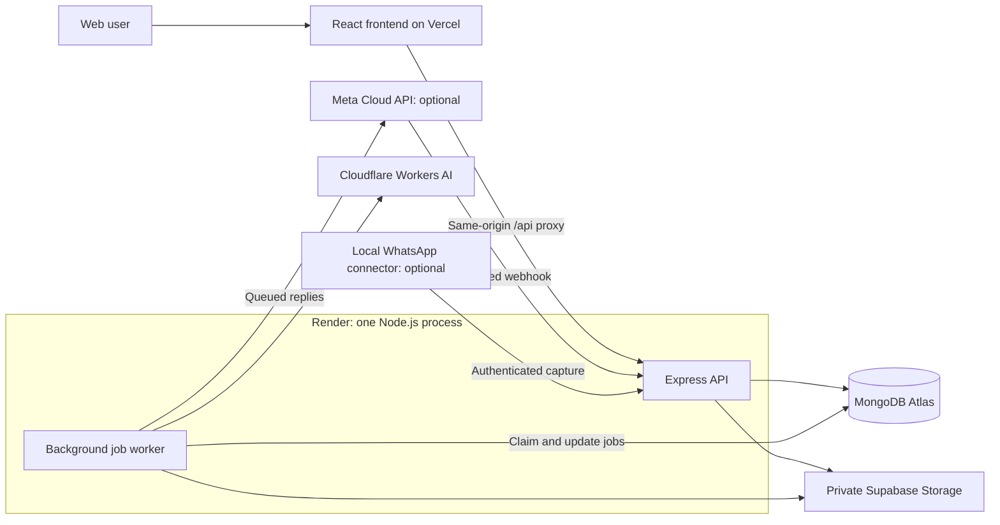

# Engram

**Save in a moment. Find when it matters.**

A personal knowledge library that turns saved notes, links, screenshots and PDFs into searchable information. Engram combines background content processing, keyword and semantic search, and answers linked to the user's saved sources.

[Live Application](https://engram-beryl.vercel.app) · [Source Code](https://github.com/Anisha-0505007/Engram) · [API Documentation](docs/api.md) · [Demo Script](docs/demo-script.md)

## Problem Statement

People often save useful information in messaging apps: an internship link, a Wi-Fi plan screenshot, a workshop poster or an important PDF. Saving is easy; finding the right item weeks later is harder. The user may remember its meaning but forget its exact wording, and useful text may be inside an image or document.

Engram addresses this retrieval problem by keeping the original content, extracting searchable information and supporting searches by topic, content type and saved date.

## Target Users

- **Students** saving study resources, application links, event posters and deadlines.
- **Young professionals** collecting reference material, documents and personal notes.
- **People who save information in WhatsApp** and want an organized library they can search later.

Evaluators can browse and search a prepared demo library without connecting WhatsApp. Authenticated capture and upload APIs also support adding demo content; the current frontend has no Quick Add or upload form.

## Solution

Engram connects capture, processing, retrieval and organization in one application:

1. **Save:** capture notes, URLs, images and PDFs through the authenticated API or a configured WhatsApp integration.
2. **Process:** a background worker extracts text, generates a title, summary, category and tags, and creates a numerical representation of the content called an embedding.
3. **Find:** search using remembered words or meaning. Engram combines keyword matches with semantic results and supports type, category and saved-date filters.
4. **Ask:** ask a question about saved content and view the retrieved sources alongside the answer.
5. **Organize:** browse sections, bookmark useful items, correct generated headings and labels, and keep sensitive items in a password-unlocked Confidential section.

Items display `pending`, `processing`, `done` or `failed`, making background work and recovery visible to the user.

## Key Features

| Feature | Application behavior |
|---|---|
| Account-based libraries | Registration, login and logout; item access is scoped to the authenticated account. |
| Capture APIs | Notes and links; JPEG, PNG, WebP and PDF uploads up to 10 MB per decoded file. The current frontend exposes WhatsApp setup rather than a Quick Add form. |
| Content enrichment | Link text and metadata, image transcription and descriptions, PDF text extraction, summaries, categories and tags. |
| Hybrid search | Atlas keyword and vector retrieval combined through Reciprocal Rank Fusion (RRF), with visible fallback warnings when dependencies are unavailable. |
| Source-linked answers | Ask retrieves saved content, checks generated citation IDs and displays source cards. Empty retrieval produces a not-found response. |
| Library organization | All Items, Links, Upcoming, Photos, Bookmarks and Confidential sections; filters and cursor-based browsing. |
| User corrections | Editable headings, categories and tags stored separately from generated enrichment so reprocessing preserves changes. |
| Durable processing | MongoDB-backed jobs, atomic claims, exponential backoff, failed-job recovery and per-user daily AI budgets. |
| Confidential items | A separate five-minute password unlock, protected media access and exclusion from normal search and AI answers. |
| Event reminders | Evidence-backed events for the next seven days, with nearer reminders within 24 hours and urgent reminders within one hour. |
| Optional WhatsApp capture | Official business-number webhook support and a separate local personal connector. |
| Web interface | Responsive desktop-style windows, section navigation, themes, onboarding and loading, empty, error and success states. |

These capabilities are implemented in the repository. Provider-dependent hosted verification and remaining submission deliverables are listed under [Deployment](#deployment) and [Limitations](#limitations-and-what-i-deliberately-didnt-build).

## Tech Stack

| Layer | Technologies |
|---|---|
| Frontend | React 18, Vite, React Router, Axios, CSS |
| Backend | Node.js, Express 5, JavaScript ES modules |
| Database | MongoDB Atlas, Mongoose |
| Search | Atlas Search, Atlas Vector Search, Reciprocal Rank Fusion |
| AI | Cloudflare Workers AI through application service wrappers |
| Media storage | Supabase Storage with a private bucket and temporary signed URLs |
| Authentication and security | bcrypt, JWT cookies, Zod, Helmet, origin validation and rate limiting |
| WhatsApp integration | Meta WhatsApp Cloud API; optional local Baileys connector |
| Deployment | Vercel frontend and API proxy; Render backend and worker |
| Testing | Native Node.js test runner, isolated in-memory MongoDB, optional Postman HTTP simulations |

The implemented provider is Cloudflare Workers AI. Generation uses `@cf/meta/llama-3.2-11b-vision-instruct`; embeddings use `@cf/baai/bge-base-en-v1.5` with 768 dimensions. PDF text extraction uses Cloudflare's document-to-Markdown endpoint. Model identifiers describe the code configuration; account access and provider terms must be checked during setup.

## Architecture

Engram has one Express backend with a worker running in the same process. The deployed React frontend runs on Vercel, which proxies `/api` requests to Render. Browser requests therefore use the frontend origin. Express can also serve a built frontend for a combined deployment.



### Architecture decisions

| Decision | Reason and trade-off |
|---|---|
| One backend and a same-process worker | Keeps deployment and debugging manageable for a student project. The worker processes jobs serially, limiting throughput. |
| MongoDB job queue | Provides durable work, atomic claims and retry scheduling without operating Redis or a separate message broker. |
| Atlas keyword and vector indexes | Keeps storage and retrieval in one database. Search indexes still require separate provisioning. |
| Keyword search plus semantic search | Exact terms and remembered meaning provide complementary signals. RRF merges ranks without comparing incompatible raw scores. |
| Small AI service wrappers | Keeps prompts, validation, provider calls and errors visible without LangChain, LangGraph or an agent framework. |
| Private object storage | Keeps binary files out of MongoDB and checks authorization before issuing temporary media links. |
| Separate user edits | Preserves manual corrections when enrichment is retried. |
| Vercel-to-Render API proxy | Supports the current hosting arrangement while keeping browser API calls on the application origin. Proxy responses disable caching. |

### Processing and retrieval

**Capture and async processing:** the API persists an item and its job before returning. The worker atomically claims runnable jobs, processes content and updates the item. Retryable failures use exponential backoff; exhausted or nonretryable jobs enter a terminal `failed` state, acting as a dead-letter queue. Heartbeats and stale-lock recovery handle interrupted work. Hitting the application AI budget leaves work pending until the next UTC day without consuming a retry attempt.

**Idempotency:** a unique `waMessageId` prevents duplicate official webhook items. The local connector uses an owner-scoped capture ID, and job deduplication prevents duplicate queued enrichment. Repeated delivery therefore reuses the saved item instead of creating another copy.

**Hybrid search:** query understanding extracts text and optional filters, validated with Zod. Keyword and vector retrieval run in parallel with ownership and privacy filters. Weak vector matches are removed before merging. RRF scores each candidate using:

```text
score(item) = sum of 1 / (60 + rank in each result list)
```

Ranks start at 1. An item appearing near the top of both lists receives contributions from both. This approach does not guarantee that hybrid search beats either input; that requires measurement. Ask uses retrieved content as context, validates source IDs and returns source cards with a warning if answer generation fails.

### Data model, indexing and security

The main collections are `users`, `linkCodes`, `items`, `jobs` and `aiUsage`. Items retain original content, media references, processing status, generated enrichment, embeddings and separate `userEdits`. Compound indexing supports `{userId, originalTimestamp, _id}` pagination and `{userId, type, originalTimestamp}` filtering. Unique indexes enforce capture deduplication.

Passwords are hashed with bcrypt. JWTs use httpOnly cookies, with `Secure` enabled in production. Protected API routes derive ownership from the verified session. Request validation, origin checks and rate limiting restrict application inputs and writes. Official webhooks verify HMAC-SHA256 over the raw request bytes with a timing-safe comparison.

The URL fetcher guards against server-side request forgery (SSRF): it accepts only HTTP/HTTPS, rejects private network addresses, pins the validated DNS address, rechecks redirects and limits fetches to three redirects, five seconds and 2 MB of HTML.

### Back-of-envelope estimation

Assuming 100 users save 20 items each day, capture volume is 2,000 items/day, averaging about 0.023 items/second. Each item embedding contains 768 numbers; 2,000 vectors represent approximately 12.3 MB of numeric values at eight bytes per value, before BSON and index overhead. Original content and media add further storage. These are planning estimates, not measured capacity: bursts, serial worker throughput and provider quotas remain constraints.

### Repository structure

```text
Engram/
├── client/                 React application and Vercel configuration
├── server/
│   ├── src/
│   │   ├── config/         Database and startup configuration
│   │   ├── controllers/    HTTP request handling
│   │   ├── middleware/     Authentication, validation and access controls
│   │   ├── models/         Mongoose schemas and indexes
│   │   ├── routes/         API and webhook routes
│   │   ├── services/       Capture, AI, search, storage and URL fetching
│   │   └── worker/         Job processing and recovery
│   ├── scripts/            Index setup, evaluation and diagnostic tools
│   └── tests/              Unit and integration tests
├── connector/              Optional local WhatsApp adapter
├── docs/                   API, deployment, evaluation and demo documentation
├── postman/                Optional AI simulation configuration
├── .env.example            Environment-variable reference
├── AGENTS.md               Development and learning protocol
└── LEARNING.md             Learning notes and topics for further study
```

## Local Setup

### Prerequisites

- Node.js 24 and npm.
- A MongoDB Atlas database accessible from the development machine.
- Cloudflare Workers AI credentials for enrichment, embeddings and Ask.
- A Supabase project with a private `engram-media` bucket for image and PDF storage.

Use a separate development database. The worker processes runnable jobs in whichever database the server uses.

### Install and configure

```sh
git clone https://github.com/Anisha-0505007/Engram.git
cd Engram/server
npm ci
cd ../client
npm ci
```

Copy `server/.env.example` to `server/.env` on your computer, then enter your own configuration. Keep the private file out of version control. Set `CLIENT_ORIGIN=http://localhost:5173` for the Vite development server.

From `server/`, provision the Atlas indexes and check their status:

```sh
node scripts/searchIndexes.mjs --apply
node scripts/searchIndexes.mjs
```

Wait until `text_index` and `vector_index` are queryable. The vector index must match the configured 768-dimensional embedding model. Changing that model requires compatible indexes and reprocessing existing items.

### Run locally

Start the backend in one terminal:

```sh
cd server
npm run dev
```

Start the frontend in another terminal:

```sh
cd client
npm run dev
```

Open [localhost:5173](http://localhost:5173). Vite proxies `/api` to Express on port 8000. Register an account, save a harmless note through a configured capture route and inspect its processing status. The [demo script](docs/demo-script.md#capture-api-helpers) includes authenticated API examples for adding synthetic content without WhatsApp. Registration and capture need MongoDB; AI processing needs valid provider access; uploads additionally need storage.

On Windows PowerShell, use `npm.cmd` if execution policy blocks the `npm.ps1` shim. Optional WhatsApp installation and pairing are documented in the [connector guide](connector/README.md) and [official integration guide](docs/whatsapp-setup.md).

## Environment Variables

Configure these on the backend host or in your private local `server/.env`. Provider credentials belong on the server; the frontend calls `/api` and needs no provider secrets. See [server/.env.example](server/.env.example) for placeholders.

| Variable | Purpose |
|---|---|
| `MONGODB_URI` | Required MongoDB connection string. |
| `JWT_SECRET` | Required private signing secret. |
| `PORT` | Local API port; defaults to `8000`. Hosting can supply its own port. |
| `NODE_ENV` | `development` locally; `production` on the deployed backend. |
| `CLIENT_ORIGIN` | Exact allowed frontend origin: `http://localhost:5173` locally or the deployed frontend URL. |
| `CLOUDFLARE_ACCOUNT_ID` | Workers AI account ID, containing exactly 32 hexadecimal characters. |
| `CLOUDFLARE_API_TOKEN` | Server token with access to the configured Workers AI services. |
| `DAILY_AI_CALL_LIMIT` | Per-user application budget per UTC day; defaults to `100` calls, independently of provider quotas. |
| `SUPABASE_URL` | Storage project URL. |
| `SUPABASE_SERVICE_ROLE_KEY` | Private server credential for the media bucket. |
| `WHATSAPP_APP_SECRET` | Optional official integration: raw-body webhook signature verification. |
| `WHATSAPP_VERIFY_TOKEN` | Optional official integration: GET webhook verification. |
| `WHATSAPP_ACCESS_TOKEN` | Optional official integration: media downloads and replies. `WHATSAPP_TOKEN` is a compatibility alias. |
| `WHATSAPP_PHONE_NUMBER_ID` | Optional official integration: business phone identifier. |
| `WHATSAPP_API_VERSION` | Optional Graph API version override; code default is `v23.0`. Verify compatibility with the configured Meta app. |
| `CLOUDFLARE_BASE_URL`, `WHATSAPP_BASE_URL` | Optional HTTP simulation or diagnostic overrides; omit for normal operation. |

Provider access, model terms and hosting quotas depend on the configured accounts; this project does not guarantee free-tier capacity. Follow the [Cloudflare setup guide](docs/cloudflare-setup.md) before testing AI processing.

## Deployment

| Component | Link or configuration |
|---|---|
| Web application | [engram-beryl.vercel.app](https://engram-beryl.vercel.app) |
| Backend health | [engram-eont.onrender.com/api/health](https://engram-eont.onrender.com/api/health) |
| Proxied API health | [engram-beryl.vercel.app/api/health](https://engram-beryl.vercel.app/api/health) |
| Vercel | Root: `client`; framework: Vite; build: `npm run build`; output: `dist`. |
| Render | Root: `server`; build: `bash build.sh`; start: `npm start`; deployment branch: `main`. |
| Official webhook | `https://engram-eont.onrender.com/webhook/whatsapp`, when Meta is configured. |
| Evaluator access | Register a separate account through the application; no shared demo credentials are published. |
| Demo video | Public recording link pending; [recording script](docs/demo-script.md) available. |

Set backend environment variables on Render and redeploy. If the backend hostname changes, update the destination in `client/vercel.json`. The Render build also copies the frontend into `server/public/` for Express serving; a standalone client build writes only to `client/dist`.

**Suggested evaluator flow:** sign in to an account with prepared demo items, search saved content, try Ask, edit a heading and bookmark an item. A newly registered account starts empty. Add content through a configured WhatsApp route or the authenticated API examples in the [demo script](docs/demo-script.md#capture-api-helpers); there is currently no browser capture form.

**Hosted verification status:** the [27 October submission audit](docs/submission-audit.md) records responding public routes and an unresolved fresh-account AI credentials failure. A complete hosted capture → enrichment → search → Ask run still requires confirmation. Cloudflare credentials are shared server configuration; registering another account does not fix them. After correcting the configuration, retry failed items to replace their stored error.

Before recording, follow [demo readiness](docs/demo-readiness.md) to verify backend settings, private media upload/download, model access, search indexes and the complete application flow. `npm run demo:preflight` from `server/` reports missing configuration without printing secrets; it does not replace the live checks.

**Official WhatsApp:** users send or forward content to Engram's business number. The Cloud API does not read their personal chat history. In Meta test mode, access is restricted to configured test numbers; see the [setup guide](docs/whatsapp-setup.md). Live delivery and replies remain unverified in the audit.

**Personal connector:** the optional unofficial adapter runs locally and captures new messages from the owner's Message Yourself chat. It requires pairing and a running local process. Its Windows installer needs a separate deployment artifact step; the standard Render build does not publish it. Hosted installer availability and live pairing remain unverified. Manual setup is available in [connector/README.md](connector/README.md).

## Testing and Verification

Run the automated checks from the repository root:

```sh
cd server
npm test
cd ../connector
npm ci
npm test
cd ../client
npm run build
```

Results from the local verification run on **27 October 2026**:

| Check | Result |
|---|---|
| Backend test suite | 49 tests: 46 passed, 3 optional simulations skipped, 0 failed. |
| Connector test suite | 12 passed, 0 failed. |
| Frontend production build | Passed. |

Tests cover authentication, cross-account access denial, capture deduplication, worker retry and recovery, quota behavior, bookmarks, Confidential access, input validation, SSRF protection, structured AI output and provider HTTP errors. Database integration tests use isolated in-memory MongoDB and temporary files under `.cache/test-tmp/`.

In-memory MongoDB does not execute Atlas Search or Atlas Vector Search. Local tests establish filter and ranking behavior, not hosted search relevance, live WhatsApp pairing or provider availability. The three optional simulations require an explicit opt-in setup described in [the simulation guide](postman/simulations/ai-local.context.md). The [submission audit](docs/submission-audit.md) records broader checks and outstanding hosted verification.

## Evaluation Results

A reproducible search-quality benchmark has **not yet been published**. No accuracy improvement over keyword-only or vector-only search is claimed.

The [evaluation guide](docs/evaluation.md) defines a comparison of keyword, vector and hybrid retrieval using at least 25 queries with expected item IDs. The runner measures **top-5 hit rate**: the fraction of queries for which at least one expected item appears in the first five results.

With a dedicated evaluation account, completed enrichment, ready Atlas indexes and `EVAL_EMAIL` / `EVAL_PASSWORD` set in the invoking shell, run from `server/`:

```sh
node scripts/evaluate.mjs ../docs/eval-cases.json
```

Create the case file first using the documented format. `EVAL_BASE_URL` optionally selects the target server. The runner compares the same cases across all three modes and writes `docs/evaluation.md` only after requests succeed without dependency warnings.

## Limitations and What I Deliberately Didn't Build

- **Hosted release completion:** fresh-account AI processing remains unverified after a reported credentials failure. A public demo video is still pending. A passing health endpoint does not establish working AI, storage or authenticated workflows.
- **Model reliability:** extraction, privacy classification, event dates and generated answers can be wrong. Citation-ID validation cannot prove that every statement is supported; users should inspect original sources.
- **Privacy scope:** Confidential is an access control, not end-to-end encryption. Explicitly marking content Confidential before saving skips AI processing; unmarked images and PDFs may reach the provider for classification. Signed media links remain usable until expiry: 60 seconds for protected/unclassified media, up to one hour for ordinary media.
- **Document retrieval:** there is no independently searchable PDF/article chunk collection. Long embedding input is split into bounded windows and combined into one vector per item, which can lose detail.
- **Reminders:** notifications appear only while the application is open. There are no push, email or WhatsApp reminder deliveries.
- **WhatsApp scope:** official delivery, personal pairing and hosted installer distribution require live verification. The personal connector uses an unofficial client and does not import historical chats.
- **Scale:** the worker is serial, rate limits are process-local and no production load benchmark has been measured. A reply sent immediately before a worker crash may be sent twice on retry despite idempotent item capture.
- **Deletion:** active processing must finish before deletion; failed media cleanup retains the item and reports a retryable error.
- **Excluded infrastructure:** no caching layer, Redis, separate message broker, separate vector database or microservices. Their deployment and consistency costs are unnecessary for the current prototype. Docker/Kubernetes, GraphQL and an agent framework were also omitted to keep the application focused and explainable.
- **Excluded features:** no chat-export import, voice-note transcription or in-WhatsApp search. Search-quality evaluation remains separate unfinished work.

## AI Usage

AI tools assisted planning, implementation, debugging, tests and documentation. Runtime AI supports extraction, enrichment, query understanding, embeddings and source-linked answer generation. Authentication, ownership checks, durable capture, retries and user corrections are handled by application code.

The author is responsible for reviewing the submitted implementation and explaining its design. [LEARNING.md](LEARNING.md) records completed learning notes and topics still marked for further study; older provider references are historical. The source and [submission audit](docs/submission-audit.md) describe the current implementation and verification limits.

Supporting submission material: [API contract](docs/api.md), [evaluation guide](docs/evaluation.md), [demo script](docs/demo-script.md), [submission template](docs/submission-template.md).
