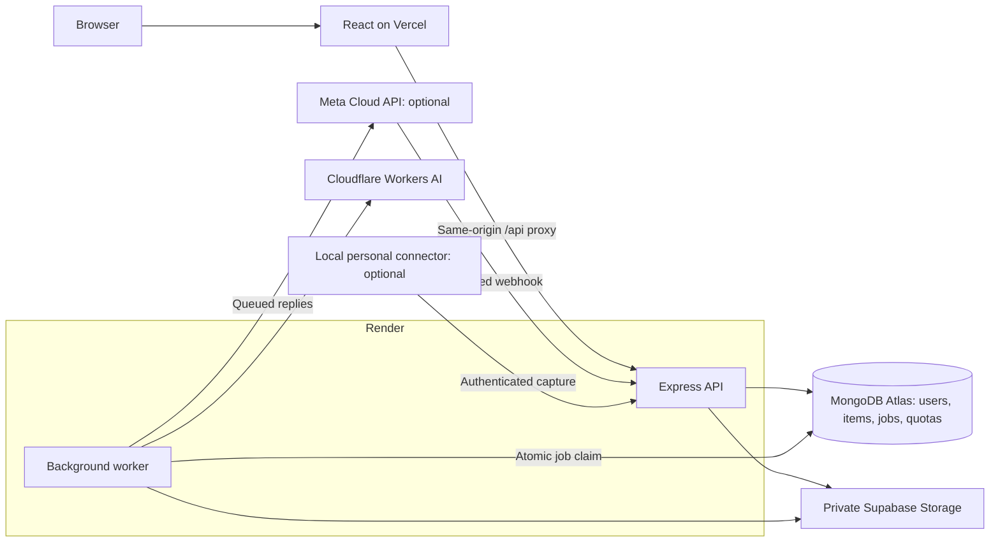

# Engram

Save in a moment. Find when it matters.

Engram is a private library for the notes, links, screenshots and PDFs people save for later. It combines durable capture, background processing, search and source-linked answers.

- **Application:** [engram-beryl.vercel.app](https://engram-beryl.vercel.app)
- **Source:** [Anisha-0505007/Engram](https://github.com/Anisha-0505007/Engram)
- **API health:** [Render backend](https://engram-eont.onrender.com/api/health)
- **Demo:** [recording script](docs/demo-script.md). A public video link still needs to be added.
- **Release checks:** [submission audit](docs/submission-audit.md), dated 27 October 2026.

**Current release status:** local automated checks and public deployment routes have been verified. A newly created hosted account has reported an AI credentials failure; successful fresh-account enrichment, media processing and search/Ask still require a complete hosted run. This README describes implemented behavior, with live limitations stated separately.

## Problem Statement

People use chats as a place to save useful information, then struggle to retrieve a link by its topic, a screenshot by its contents, or a document by what it describes. Content is scattered across message types, and relevant details can be hidden inside an image or PDF.

## Target Users

Students and young professionals who save study material, application links, workshop details, screenshots and personal notes. Evaluators can try the web workflow without connecting a WhatsApp account.

## Solution

Engram supports four connected workflows:

1. **Capture:** save a note, URL, image or PDF from the web. Optional WhatsApp capture feeds the same item and job pipeline.
2. **Process and find:** a Mongo-backed worker extracts useful text, labels content and creates embeddings. Search combines keyword matches and semantic results; Ask attempts to answer from retrieved saved items with source references.
3. **Organize and correct:** browse sections, filter results, bookmark items, edit headings/tags/categories, and retry failed processing without losing the original.
4. **Protect:** accounts own their data. Confidential items require a separate password unlock and stay outside normal search and AI answers.

## Key Features

- Registration, login and logout with bcrypt password hashing and a JWT in an httpOnly cookie.
- Web Quick Add for text and links; JPEG, PNG, WebP and PDF uploads, up to 10 MB decoded.
- Visible pending, processing, done and failed states; durable jobs, retries, daily AI budgets and stuck-job recovery.
- Link metadata extraction, image transcription, PDF text extraction, structured enrichment and 768-dimensional embeddings through Cloudflare Workers AI.
- Atlas keyword and vector search merged with Reciprocal Rank Fusion (RRF); explicit keyword fallback warnings.
- Ask with saved source cards, citation checks, and a not-found or answer-generation fallback.
- All items, Links, Upcoming, Photos, Bookmarks and Confidential sections.
- Original saved-date, type, category and processing-status filters; stable cursor pagination for browsing.
- Editable headings, categories and tags that survive reprocessing; deletion with associated media/job cleanup.
- Evidence-supported event dates and in-app reminders: within 24 hours of a future event, urgent within one hour, while the app is open.
- Confidential access with a five-minute unlock tied to the current login; private content excluded from AI retrieval.
- Responsive desktop-style UI, individual window themes, time-based wallpaper, a signup tour and one active section at a time.
- Optional official business-number ingestion and a separate optional local personal connector. Their deployment requirements are described below.

These are implementation capabilities, not a claim that every provider-dependent feature has passed on the hosted release.

## Tech Stack

| Component | Technology |
|---|---|
| Frontend | React 18, Vite, React Router, Axios, CSS |
| Backend | Node.js, Express 5, JavaScript ES modules |
| Database | MongoDB Atlas and Mongoose |
| Retrieval | Atlas Search, Atlas Vector Search, RRF |
| AI integration | Cloudflare Workers AI REST API behind small application wrappers |
| Private media | Supabase Storage, private bucket and signed URLs |
| Authentication and validation | bcrypt, JWT cookies, Zod, Helmet, explicit origin checks and rate limits |
| Optional ingestion | Meta WhatsApp Cloud API; separate local Baileys connector |
| Hosting | Vercel frontend/proxy; Render Express API and worker |
| Verification | Native Node test runner, in-memory MongoDB; optional Postman HTTP simulation |

## Architecture

The backend is one Express application with a worker in the same process. The frontend is deployed separately, and Vercel forwards browser requests under `/api` to Render. The browser keeps its session cookie on the frontend domain.



| Decision | Reason and trade-off |
|---|---|
| One backend with a same-process worker | Straightforward to operate for this prototype. Worker throughput is limited; HTTP health alone does not prove AI readiness. |
| Vercel proxy to Render | Frontend and API can use separate hosts while browser authentication stays on one origin. API proxy caching is disabled. |
| MongoDB job collection | Atomic claims, idempotency, retry scheduling and a terminal failed state without another infrastructure service. |
| Atlas search in the application database | Owner filters and search indexes share the existing data store. Search indexes must be provisioned separately. |
| Plain HTTP AI wrappers | Provider errors, structured-output validation and repair remain visible without an agent framework. |
| Private object storage | Media does not fill MongoDB storage. The backend checks access before issuing a signed URL. |

Capture returns after the item and job are stored; AI runs asynchronously. Unique message/capture IDs and job deduplication keys prevent duplicate items/jobs. Failed transient work uses exponential backoff; exhausted or nonretryable jobs remain failed until Retry. Heartbeats and stale-lock recovery handle interrupted work.

Search parses the query into text and optional filters, validates the result, and falls back to plain text on parsing failure. Keyword and vector retrieval apply ownership/privacy filters. RRF combines ranks using `1 / (60 + rank)`; it does not guarantee better results than either input. Low-confidence vector results are excluded.

Primary records are `users`, `linkCodes`, `items`, `jobs` and `aiUsage`. Items retain original content, enrichment and separate `userEdits`, so reprocessing preserves user corrections. Indexes cover owner/timestamp, owner/type, capture uniqueness and runnable jobs.

At an assumed 100 users saving 20 items each day, the system receives 2,000 items/day. A vector contains 768 numeric values; BSON and index overhead add storage. This is a planning assumption, not a load-test result. Serial processing, storage and provider quotas constrain capacity.

Redis, a separate message broker, a separate vector database, microservices and an agent framework were omitted because this pipeline does not currently require their operational complexity. Rate limits are held in memory and are intended for one API instance.

## Local Setup

Use Node.js 24 and npm. Use a separate development database: the worker processes jobs from whichever database the backend is configured to use.

1. Clone the repository and install the application dependencies:

   ```sh
   git clone https://github.com/Anisha-0505007/Engram.git
   cd Engram/server
   npm ci
   cd ../client
   npm ci
   ```

2. Copy `server/.env.example` to `server/.env` on your own computer and fill the required values from the table below. Do not commit that file.
3. Configure MongoDB Atlas access for your development machine.
4. Create a **private** Supabase bucket named `engram-media` for uploads.
5. Start the backend in one terminal:

   ```sh
   cd server
   npm run dev
   ```

6. Start the frontend in another terminal:

   ```sh
   cd client
   npm run dev
   ```

7. Open http://localhost:5173. Vite forwards `/api` to Express at port 8000. Registration and basic saving require the database; enrichment additionally requires valid AI access, and uploads require storage.

Create/check the Atlas search indexes from `server/`:

```sh
node scripts/searchIndexes.mjs --apply
node scripts/searchIndexes.mjs
```

Wait until `text_index` and `vector_index` are queryable. The vector index must match the configured 768-dimensional model. Reprocess existing items when their embedding model changes.

`npm run build` in `client/` writes to **client/dist**, not directly to Express. For a combined Express deployment, `bash build.sh` in `server/` installs dependencies, builds the frontend and copies its output into `server/public/`. The Vercel deployment uses `client/dist` independently.

On Windows PowerShell, use `npm.cmd` if the shell blocks the `npm.ps1` shim.

## Environment Variables

Set backend variables on **Render**, or in your private local backend environment. The frontend does not need provider secrets.

| Variable | Purpose |
|---|---|
| `MONGODB_URI` | Required Atlas connection string. |
| `JWT_SECRET` | Required private signing secret. |
| `NODE_ENV` | Set to `production` on Render for secure production cookies. |
| `PORT` | Local port; defaults to 8000. Hosting supplies its assigned port. |
| `CLIENT_ORIGIN` | Exact allowed frontend origin. Production: `https://engram-beryl.vercel.app`; development: `http://localhost:5173`. |
| `CLOUDFLARE_ACCOUNT_ID` | Account ID containing exactly 32 hexadecimal characters; required for AI. |
| `CLOUDFLARE_API_TOKEN` | Workers AI token; required for AI. |
| `DAILY_AI_CALL_LIMIT` | Application budget per user per UTC day; defaults to 100 calls. This is separate from provider quotas. |
| `SUPABASE_URL` | Storage project URL; required for media. |
| `SUPABASE_SERVICE_ROLE_KEY` | Private server storage key; required for media. |
| `WHATSAPP_APP_SECRET` | Optional official integration: webhook signature verification. |
| `WHATSAPP_VERIFY_TOKEN` | Optional official integration: Meta GET verification. |
| `WHATSAPP_ACCESS_TOKEN` | Optional official integration: Graph API/media/replies. `WHATSAPP_TOKEN` is a compatibility alias. |
| `WHATSAPP_PHONE_NUMBER_ID` | Optional official integration: business phone identifier. |
| `WHATSAPP_API_VERSION` | Optional Graph version override; code default is `v23.0`. Check your Meta application's supported version. |
| `CLOUDFLARE_BASE_URL`, `WHATSAPP_BASE_URL` | Optional diagnostic/simulation overrides. Normally omit them. |

The code uses Cloudflare models `@cf/meta/llama-3.2-11b-vision-instruct` and `@cf/baai/bge-base-en-v1.5`. Provider access and current terms must be checked for the configured account; no free-tier capacity is guaranteed here. See [Cloudflare setup](docs/cloudflare-setup.md).

The old `VITE_API_BASE_URL` setting is unused. The frontend calls `/api`; `client/vercel.json` contains the Render destination. Update that public destination if the backend hostname changes.

Cloudflare settings are shared by all Engram accounts on a backend process. Its credentials error is raised before the per-user quota check. A failed item's error remains stored until Retry/reprocessing; creating another account does not supply server credentials.

## Deployment

| Service | URL / settings |
|---|---|
| Frontend | https://engram-beryl.vercel.app |
| Vercel settings | Root `client`; preset `Vite`; build `npm run build`; output `dist`; automatic dependency installation. |
| Backend | https://engram-eont.onrender.com |
| Render settings | Root `server`; build `bash build.sh`; start `npm start`; branch `main`. |
| Browser API | https://engram-beryl.vercel.app/api/health, proxied to Render. |
| Official webhook, if configured | `https://engram-eont.onrender.com/webhook/whatsapp` |

Add backend environment variables on Render and redeploy that service. Public health routes establish HTTP availability, not successful model calls, media access or a complete authenticated workflow.

**Evaluator path:** open the frontend, register an account, use Quick Add, and inspect processing/search. WhatsApp setup is optional. A current hosted AI-processing failure is recorded in [the submission audit](docs/submission-audit.md) and must be resolved before claiming the complete AI workflow works.

**Official WhatsApp:** users send/forward to Engram's business number, not directly from their private chat history. Meta test mode requires whitelisted numbers. Live delivery and replies have not been certified in this audit.

**Personal WhatsApp connector:** an optional unofficial local adapter captures new messages from the user's own Message Yourself chat. It requires a local process and pairing; it cannot import history or be started/paired by a normal browser alone. Parser/outbox/capture tests do not prove live pairing. See [setup and limitations](connector/README.md).

The Windows installer exists as a local build but is Git-ignored and needs a separate deployment artifact step. The standard Render build does not publish it automatically; hosted download availability is unverified. The endpoint returns an explicit unavailable response if it is absent. Use the documented manual connector setup until the hosted artifact and pairing are verified.

A public demo video link and any dedicated demo account must be provided after recording and checking access. Do not publish credentials for an account containing personal content.

## Testing and Verification

```sh
cd server
npm test
cd ../connector
npm ci
npm test
cd ../client
npm run build
```

The native Node tests cover authentication, ownership isolation, capture deduplication, worker transitions, quota behavior, validation, privacy, bookmarks, SSRF and provider HTTP error handling. Database tests use isolated in-memory MongoDB, with temporary files under the ignored `.cache/test-tmp/` directory.

Atlas Search/Vector Search cannot run in that in-memory database. The tests verify filter/ranking logic and local behavior; real Atlas relevance and hosted providers require separate checks. Optional Postman simulations are disabled by default. [Simulation instructions](postman/simulations/ai-local.context.md) explain the explicit opt-in run.

Current commands, results, scope and remaining release checks are recorded in [submission-audit.md](docs/submission-audit.md). Pattern-based repository checks are useful evidence, not an exhaustive security certification. Private environment/session files were not opened or printed.

## Evaluation Results

No current, reproducible semantic-quality score is published. [docs/evaluation.md](docs/evaluation.md) describes how to create at least 25 real query/expected-item cases and run `server/scripts/evaluate.mjs`. Report measured top-5 hit rate; do not describe it as multi-item recall or invent improvements over keyword search.

## Limitations and What I Deliberately Didn't Build

- Hosted enrichment for a fresh account still needs verification after the reported Cloudflare configuration error. Old completed items and a green health route do not establish current AI availability.
- Model-generated OCR, PDF extraction, date classification and answers can be incomplete or incorrect. Source checks are necessary.
- Confidential is an access control, not end-to-end encryption. Explicitly marking content Confidential before saving skips AI; unmarked media may reach the AI provider for classification. Detection is not perfect.
- Signed URLs remain usable until expiry: 60 seconds for protected/unclassified media, up to one hour for ordinary media.
- No PDF/article chunk retrieval, voice transcription, historical chat import, in-WhatsApp search, push notifications, email reminders or WhatsApp reminder delivery.
- In-app reminders require the application to be open.
- Live WhatsApp pairing/delivery and hosted installer distribution remain unverified and are optional integrations.
- The worker is serial, rate limits are process-local, and no production load test has been measured.
- A reply sent just before a worker crash can be sent twice on retry, even though item capture is idempotent.
- Deletion during active processing returns a retry message; storage cleanup failure retains the item rather than claiming successful deletion.
- Citation format checks cannot prove that every generated statement is factually supported.

## AI Usage

AI tools assisted brainstorming, implementation, debugging, documentation and tests. The submitted source, decisions and demo remain the author's responsibility. Tests and simulations only establish the behavior they exercise.

`LEARNING.md` contains historical study notes, including earlier provider names and unfinished evaluation plans; the current source, this README and the dated audit describe the present implementation. The author should be able to explain the capture pipeline, owner filtering, job retry, search fusion and authentication design.

For recording, use [the timed demo script](docs/demo-script.md). For final links and the official form, use [the submission template](docs/submission-template.md). Completing these files does not submit the project.
